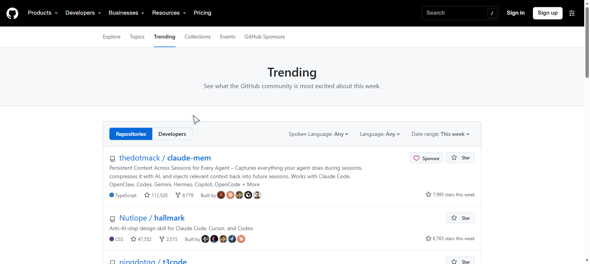
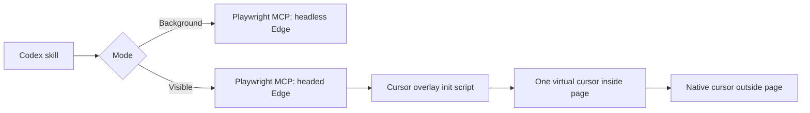

# Agent Computer Browser Modes

<p align="center">
  <a href="https://github.com/Slaslin/agent-computer-browser-modes/stargazers"></a>
  
  
  
  
</p>

**Give your AI agent a browser it can actually control, without losing control of your mouse.**

Agent Computer Browser Modes is a Codex skill for AI agents that need to operate
Microsoft Edge. It combines silent headless browser automation with a visible,
recording-friendly virtual cursor. Use it when an agent should work in the
background without stealing focus, or when users need to watch every mouse
movement, click, focus change, and page navigation.

[Quick Start](#quick-start) • [Two Modes](#two-modes) • [How It Works](#how-it-works) • [FAQ](#faq) • [简体中文](README.zh-CN.md)



## Why This Exists

Most agent browser tools are invisible. They click through pages in a headless
browser, which is great for speed, but impossible to trust, demo, or debug.

Desktop Computer Use tools solve visibility by taking over the operating system
pointer. That is the wrong tradeoff for browser-only work: the browser steals
focus, the real cursor moves across the desktop, and screen recordings can show
duplicate cursors.

Agent Computer Browser Modes gives you both models in one skill:

- **Background mode** for work that should stay quiet and out of the way.
- **Visible mode** for work that should be observable, recordable, and easy to
  interrupt or hand off.

Inside page content, visible mode shows one cursor instead of making the real
pointer fight the agent pointer. Move to browser tabs, the address bar, or the
Windows taskbar, and native cursor behavior returns automatically.

## Two Modes

| Mode | Best for | Behavior |
| --- | --- | --- |
| `browser_background` | Data collection, testing, form filling, long tasks | Headless Edge, no window, no focus stealing |
| `browser_visible` | Demos, screen recording, visual verification, human handoff | Headed Edge, smooth virtual cursor, click ripples, focus highlights |

Both modes use the same browser engine and Playwright MCP foundation, so you can
move a workflow from invisible to visible without rewriting the automation.

## Quick Start

Requirements: Windows, Codex desktop, Node.js 20+, and Microsoft Edge.

```powershell
git clone https://github.com/Slaslin/agent-computer-browser-modes.git
cd agent-computer-browser-modes
npm install
npm run install-skill
```

Restart Codex or open a new conversation so the MCP servers can load.

Verify:

```powershell
codex mcp get browser_background
codex mcp get browser_visible
```

Then ask Codex:

```text
Use agent-computer-browser-modes in background mode to collect the results.
Use agent-computer-browser-modes in visible mode and let me watch the flow.
```

The installer copies the skill into
`%CODEX_HOME%\skills\agent-computer-browser-modes`, backs up `config.toml`, and
replaces only its own marked configuration block.

## What Makes It Different

| Capability | Headless Playwright | OS Computer Use | Agent Computer Browser Modes |
| --- | --- | --- | --- |
| Runs without a browser window | Yes | No | Yes |
| Shows mouse movement | No | Yes | Yes |
| Keeps browser work from stealing focus | Yes | No | Yes in background mode |
| Uses the real Windows pointer | No | Yes | No |
| One visible cursor inside page content | N/A | Not guaranteed | Yes |
| Recording-friendly page interaction | No | Often produces duplicate cursors | Yes |
| Returns native cursor over browser chrome | N/A | N/A | Yes |

## How It Works



The visible overlay is injected with Playwright's `--init-script`. It does not
intercept clicks and does not replace Playwright input. Page clicks still happen
through the browser automation layer.

For agent-driven movement, the skill calls:

```js
window.__codexVisualCursor.moveTo(x, y, 260)
```

Real pointer movement inside the page is applied immediately without
interpolation, so the cursor stays responsive. Leaving the page root restores
the native cursor. Re-entering the page restores the virtual cursor.

## Screen Recording

The virtual cursor is page content, so it is captured by tab or window
recording. The native page cursor is hidden while the overlay owns the page.

If a display recorder independently captures the system pointer, disable its
cursor layer or record only the browser content area. Browser tabs and the
address bar remain native UI by design.

## Safety

- No passwords are requested or typed.
- Consequential submissions require confirmation.
- Unsafe page scripting, uploads, drag/drop, and dialogs remain approval-gated.
- Page content is treated as untrusted.
- The visible mode is browser-level automation, not OS-wide Computer Use.

## FAQ

<details>
<summary><b>Does this move the real Windows mouse?</b></summary>

No. Visible mode draws a virtual cursor inside the page. It does not move the
Windows system pointer or control other desktop applications.
</details>

<details>
<summary><b>Why use this instead of Computer Use for browser tasks?</b></summary>

Computer Use is appropriate when an agent must operate desktop apps or browser
chrome. This skill is narrower and safer for webpage work: it does not need to
take the OS pointer, and background mode can run without stealing focus.
</details>

<details>
<summary><b>Why not just use headless Playwright?</b></summary>

Use background mode when nobody needs to watch. Use visible mode when the user
needs to trust, record, debug, or hand off the workflow. The same skill supports
both.
</details>

<details>
<summary><b>Can I use Chrome instead of Edge?</b></summary>

The installer currently configures Edge. The cursor overlay is browser-agnostic;
Chrome support is a planned configuration extension.
</details>

## Troubleshooting

- **MCP server missing:** open a new Codex conversation so the servers reload.
- **Profile already in use:** close the matching Edge profile before relaunching
  the same mode.
- **Cursor missing:** confirm the visible server includes
  `scripts/cursor-overlay.js` through `--init-script`.
- **Duplicate cursor in a recording:** disable system-pointer capture in the
  recorder or record the page content instead of the full display.

More detail: [configuration](references/configuration.md) and
[cursor behavior](references/cursor-behavior.md).

## Development

```powershell
npm test
npm run validate
```

The smoke test covers virtual cursor display, native cursor suppression, real
pointer tracking, child-element transitions, page exit and re-entry, and actual
page clicks.

## Contributing

Issues and pull requests are welcome. Keep changes focused, include a test for
cursor behavior or installer changes, and verify both background and visible
modes before opening a pull request.

## License

MIT
