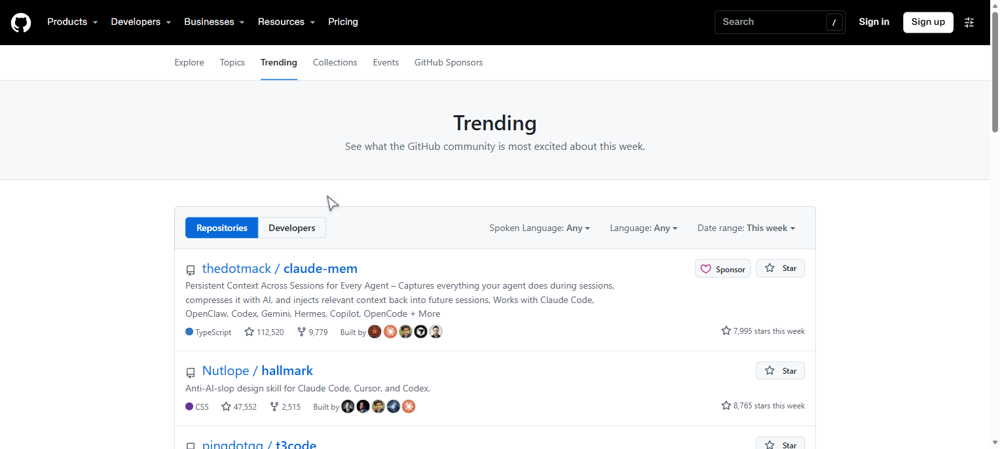
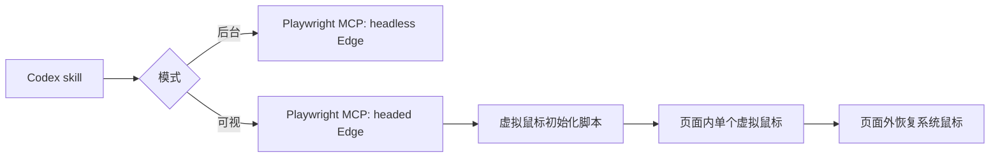

# Agent Computer Browser Modes

<p align="center">
  <a href="https://github.com/Slaslin/agent-computer-browser-modes/stargazers"></a>
  
  
  
  
</p>

**让 AI Agent 真正能操作浏览器，同时不抢走你对鼠标的控制。**

Agent Computer Browser Modes 是一个给 Codex 使用的浏览器控制 skill。它把两种能力放在同一个包里：后台静默运行的 headless 浏览器自动化，以及适合演示和录屏的可见虚拟鼠标。

需要让 Agent 在不抢焦点的情况下处理网页时，用后台模式；需要让用户看见鼠标移动、点击、输入焦点和页面跳转时，用可视模式。

[快速开始](#快速开始) • [两种模式](#两种模式) • [工作原理](#工作原理) • [English](README.md)



## 为什么需要它

大多数 Agent 浏览器工具完全不可见。它们在后台飞快点击网页，适合执行任务，但不方便信任、演示和调试。

桌面 Computer Use 虽然能显示指针，却会接管整个操作系统鼠标。对于纯网页任务，这会带来额外问题：浏览器抢焦点、真实鼠标在桌面上移动、录屏里可能出现两个鼠标。

这个项目把两者拆开：

- **后台模式**负责安静干活，不弹窗、不抢焦点。
- **可视模式**负责展示过程，适合录屏、验证和人工接管。

可视模式的鼠标进入网页内容区后，页面里只保留一个虚拟鼠标。鼠标移动到浏览器标签栏、地址栏或 Windows 任务栏时，会自动恢复系统鼠标。

## 两种模式

| 模式 | 适用场景 | 行为 |
| --- | --- | --- |
| `browser_background` | 数据收集、测试、填表、长时间任务 | Headless Edge，无窗口，不抢焦点 |
| `browser_visible` | 演示、录屏、可视验证、人工接管 | 可见 Edge，平滑虚拟鼠标，点击波纹，焦点高亮 |

两种模式共用 Playwright MCP 底座。普通任务可以静默执行，需要展示时切换成可视模式。

## 快速开始

环境要求：Windows、Codex desktop、Node.js 20+、Microsoft Edge。

```powershell
git clone https://github.com/Slaslin/agent-computer-browser-modes.git
cd agent-computer-browser-modes
npm install
npm run install-skill
```

安装完成后重启 Codex，或者新开一个对话，让 MCP 服务重新加载。

```powershell
codex mcp get browser_background
codex mcp get browser_visible
```

然后在 Codex 里直接说：

```text
使用 agent-computer-browser-modes 的后台模式帮我处理这个页面。
使用 agent-computer-browser-modes 的可视模式，让我看着你操作。
```

安装器会把 skill 放到 `%CODEX_HOME%\skills\agent-computer-browser-modes`，备份 `config.toml`，并且只替换自己的配置块。

## 和普通方案的区别

| 能力 | Headless Playwright | 系统 Computer Use | Agent Computer Browser Modes |
| --- | --- | --- | --- |
| 无浏览器窗口运行 | 是 | 否 | 是 |
| 显示鼠标移动 | 否 | 是 | 是 |
| 后台执行不抢焦点 | 是 | 否 | 后台模式是 |
| 移动真实 Windows 鼠标 | 否 | 是 | 否 |
| 页面内只有一个可见鼠标 | 不适用 | 不保证 | 是 |
| 适合网页录屏 | 否 | 容易出现双鼠标 | 是 |
| 回到浏览器外壳恢复系统鼠标 | 不适用 | 不适用 | 是 |

## 工作原理



虚拟鼠标通过 Playwright 的 `--init-script` 注入，不会拦截页面点击。真正的点击仍然由 Playwright 发送给浏览器。

Agent 主动移动时调用：

```js
window.__codexVisualCursor.moveTo(x, y, 260)
```

真实鼠标在页面内移动时不使用插值，直接更新位置，避免卡顿和抢鼠标感。鼠标离开页面根节点后恢复系统鼠标，重新进入页面后恢复虚拟鼠标。

## 录屏说明

虚拟鼠标属于页面内容，所以标签页录制或窗口录制都会把它录进去。页面内容区的真实系统鼠标会被隐藏。

如果录屏软件自己会额外捕获系统鼠标，请关闭它的鼠标捕获，或者只录制浏览器内容区域。浏览器标签栏和地址栏属于原生窗口 UI，不归页面控制。

## 安全边界

- 不请求、不输入密码。
- 提交、购买、发送消息、修改权限等有副作用操作需要确认。
- 不安全的页面脚本、上传、拖拽和弹窗处理保持审批。
- 页面内容视为不可信输入。
- 可视模式是浏览器级自动化，不是系统级 Computer Use。

## 常见问题

<details>
<summary><b>它会移动真实的 Windows 鼠标吗？</b></summary>

不会。可视模式只在网页里绘制一个虚拟鼠标，不会移动系统鼠标，也不会控制其他桌面软件。
</details>

<details>
<summary><b>为什么不直接用 Computer Use？</b></summary>

需要操作桌面软件或浏览器外壳时，Computer Use 更合适。纯网页任务使用这个 skill 更窄、更安全，也不需要占用系统鼠标。
</details>

<details>
<summary><b>为什么不直接用 headless Playwright？</b></summary>

不需要展示时用后台模式。需要录屏、可视验证、调试或人工接管时用可视模式。一个 skill 同时覆盖两种场景。
</details>

## 开发和验证

```powershell
npm test
npm run validate
```

测试覆盖虚拟鼠标显示、系统鼠标隐藏、真实鼠标即时跟随、子元素切换、页面进出恢复和实际网页点击。

## 许可证

MIT
